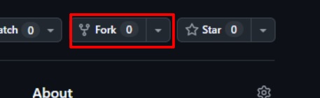
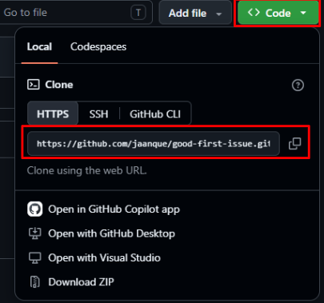
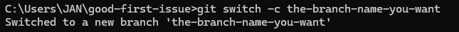
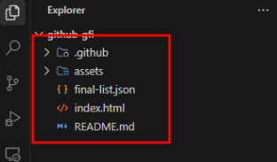
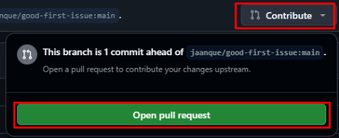

<div align="center">

# GOOD FIRST ISSUE

[](https://github.com/ellerbrock/open-source-badge/)
[](https://opensource.org/licenses/MIT)

[](https://github.com/jaanque/good-first-issue/commits/main)

##

<details>
  <summary><b>لغات أخرى؟ بالتأكيد!</b></summary>
  <br/>

<table>
  <tr>
    <td align="center" width="55">
      <a href="README-zh.md">
        <br />
        <sub><b>中文</b></sub>
      </a>
    </td>
    <td align="center" width="55">
      <a href="README-hi.md">
        <br />
        <sub><b>हिन्दी</b></sub>
      </a>
    </td>
    <td align="center" width="55">
      <a href="README-es.md">
        <br />
        <sub><b>Español</b></sub>
      </a>
    </td>
    <td align="center" width="55">
      <a href="README-ar.md">
        <br />
        <sub><b>العربية</b></sub>
      </a>
    </td>
    <td align="center" width="55">
      <a href="README-bn.md">
        <br />
        <sub><b>বাংলা</b></sub>
      </a>
    </td>
    <td align="center" width="55">
      <a href="README-fr.md">
        <br />
        <sub><b>Français</b></sub>
      </a>
    </td>
    <td align="center" width="55">
      <a href="README-ru.md">
        <br />
        <sub><b>Русский</b></sub>
      </a>
    </td>
    <td align="center" width="55">
      <a href="README-pt.md">
        <br />
        <sub><b>Português</b></sub>
      </a>
    </td>
    <td align="center" width="55">
      <a href="README-ur.md">
        <br />
        <sub><b>اردو</b></sub>
      </a>
    </td>
    <td align="center" width="55">
      <a href="README-id.md">
        <br />
        <sub><b>Bahasa Indonesia</b></sub>
      </a>
    </td>
  </tr>
  <tr>
    <td align="center" width="55">
      <a href="README-de.md">
        <br />
        <sub><b>Deutsch</b></sub>
      </a>
    </td>
    <td align="center" width="55">
      <a href="README-ja.md">
        <br />
        <sub><b>日本語</b></sub>
      </a>
    </td>
    <td align="center" width="55">
      <a href="README-tr.md">
        <br />
        <sub><b>Türkçe</b></sub>
      </a>
    </td>
    <td align="center" width="55">
      <a href="README-vi.md">
        <br />
        <sub><b>Tiếng Việt</b></sub>
      </a>
    </td>
    <td align="center" width="55">
      <a href="README-tl.md">
        <br />
        <sub><b>Tagalog</b></sub>
      </a>
    </td>
    <td align="center" width="55">
      <a href="README-ko.md">
        <br />
        <sub><b>한국어</b></sub>
      </a>
    </td>
    <td align="center" width="55">
      <a href="README-fa.md">
        <br />
        <sub><b>فارسی</b></sub>
      </a>
    </td>
    <td align="center" width="55">
      <a href="README-th.md">
        <br />
        <sub><b>ไทย</b></sub>
      </a>
    </td>
    <td align="center" width="55">
      <a href="README-it.md">
        <br />
        <sub><b>Italiano</b></sub>
      </a>
    </td>
    <td align="center" width="55">
      <a href="README-pl.md">
        <br />
        <sub><b>Polski</b></sub>
      </a>
    </td>
  </tr>
  <tr>
    <td align="center" width="55">
      <a href="README-uk.md">
        <br />
        <sub><b>Українська</b></sub>
      </a>
    </td>
    <td align="center" width="55">
      <a href="README-nl.md">
        <br />
        <sub><b>Nederlands</b></sub>
      </a>
    </td>
    <td align="center" width="55">
      <a href="README-ro.md">
        <br />
        <sub><b>Română</b></sub>
      </a>
    </td>
    <td align="center" width="55">
      <a href="README-el.md">
        <br />
        <sub><b>Ελληνικά</b></sub>
      </a>
    </td>
    <td align="center" width="55">
      <a href="README-cs.md">
        <br />
        <sub><b>Čeština</b></sub>
      </a>
    </td>
    <td align="center" width="55">
      <a href="README-hu.md">
        <br />
        <sub><b>Magyar</b></sub>
      </a>
    </td>
    <td align="center" width="55">
      <a href="README-sv.md">
        <br />
        <sub><b>Svenska</b></sub>
      </a>
    </td>
    <td align="center" width="55">
      <a href="README-he.md">
        <br />
        <sub><b>עברית</b></sub>
      </a>
    </td>
    <td align="center" width="55">
      <a href="README-ca.md">
        <br />
        <sub><b>Català</b></sub>
      </a>
    </td>
  </tr>
</table>
</details>

##

هل هذه هي المرة الأولى التي تستخدم فيها Git وGitHub؟ **أنت في المكان الصحيح تماماً!**

تم تصميم هذا المستودع لمساعدتك على اتخاذ خطواتك الأولى في عالم **المصادر المفتوحة (Open Source)** في بيئة آمنة تماماً ودون خوف من إفساد أي شيء.

أؤمن بأن أفضل طريقة للتعلم هي **الممارسة والتطبيق**، لذلك أنشأت مشروعاً بسيطاً يمكنك تعديله وتطويره بكل سهولة.

**مهمتك بسيطة للغاية:** اتبع التعليمات خطوة بخطوة لإضافة اسمك وصورتك إلى المشروع.

**هل أنت مستعد للانطلاق؟** انتقل إلى **الخطوة 1** ولنبدأ معاً!

</div>

---

## الأدوات الأساسية

قبل البدء، تأكد من توفر الأدوات الأساسية التالية لديك:

| الأداة              |                                                               Logo                                                               | الوصف                                                       | الرابط                                             |
| :------------------ | :------------------------------------------------------------------------------------------------------------------------------: | :---------------------------------------------------------- | :------------------------------------------------- |
| **حساب GitHub**     |   | أنشئ حسابك لاستضافة الشيفرات البرمجية والمساهمة             | [تسجيل](https://github.com/signup)                 |
| **Git**             |            | أداة التحكم في الإصدارات لإدارة تعديلات الشيفرة البرمجية     | [تحميل](https://git-scm.com/downloads)            |
| **VS Code**         |  | محرر الشيفرات الموصى به _(أو محررك المفضل)_                 | [تحميل](https://code.visualstudio.com/download)   |

## 1. انسخ المستودع (FORK)

الـ **Fork** هو نسختك الخاصة من هذا المستودع تحت حسابك على GitHub. يتيح لك إجراء التعديلات بأمان تام دون التأثير على المشروع الأصلي!

1. انتقل إلى الزاوية العلوية اليمنى من هذه الصفحة وانقر فوق زر **Fork**:

   <br/>

   

   <br/>

2. في صفحة **Create a new fork**، اترك اسم المستودع كما هو وانقر على **Create fork**.

3. بعد ثوانٍ قليلة، سيعيد GitHub توجيهك إلى نسختك الجديدة على الرابط:

   `https://github.com/<اسم-المستخدم-الخاص-بك>/good-first-issue`

🎉 **رائع جداً!** أصبح لديك الآن نسختك الخاصة من المشروع.

## 2. استنسخ المستودع (CLONE)

تحتاج الآن إلى تحميل المستودع المنسوخ إلى جهاز الكمبيوتر الخاص بك لتتمكن من تعديل الملفات محلياً.

1. في **صفحة المستودع المنسوخ الخاص بك** على GitHub، انقر فوق الزر الأخضر "**<> Code**".
2. في القائمة المنسدلة، تأكد من تحديد علامة التبويب **HTTPS**، ثم انقر فوق أيقونة النسخ لنسخ رابط المستودع:

   <br/>

   

   <br/>

3. افتح سطر الأوامر (Terminal) ونفّذ الأمر `git clone` متبوعاً بالرابط الذي نسخته:

   ```bash
   git clone https://github.com/<اسم-المستخدم-الخاص-بك>/good-first-issue.git
   ```

> [!NOTE]
> استبدل `<اسم-المستخدم-الخاص-بك>` باسم مستخدم GitHub الحقيقي الخاص بك!

4. بعد اكتمال التحميل، انتقل إلى مجلد المشروع:

   ```bash
   cd good-first-issue
   ```

🚀 **عمل رائع!** ملفات المشروع أصبحت الآن على جهازك وأنت مستعد للبدء بالتعديل.

## 3. أنشئ فرعاً جديداً (BRANCH)

قبل إجراء أي تعديلات، يُفضل دائماً إنشاء فرع جديد. العمل على فرع منفصل يحافظ على ترتيب عملك ويبقي الفرع الرئيسي `main` نظيفاً.

1. في سطر الأوامر (داخل مجلد `good-first-issue`)، نفّذ الأمر `git switch -c` متبوعاً باسم فرعك:

   ```bash
   git switch -c <اسم-الفرع-الخاص-بك>
   ```

   _(اختر اسماً واضحاً، مثل `add-اسمك` أو `الاسم-الذي-تفضله`)_

2. سيؤكد Git إنشاء الفرع الجديد والانتقال إليه:

   <br/>

   

   <br/>

> [!NOTE]
> ملاحظة: إذا كنت تستخدم إصداراً أقدم من Git، يمكنك أيضاً استخدام الأمر `git checkout -b <اسم-الفرع-الخاص-بك>`.

🌿 **أنت جاهز!** أي تعديلات تقوم بها من الآن فصاعداً ستبقى ضمن فرعك الجديد.

## 4. افتح المشروع في محرر الأكواد

الآن بعد أن أصبح المشروع على جهازك والفرع جاهز، حان وقت فتحه في محرر الأكواد. في هذا الدليل سنستخدم **Visual Studio Code (VS Code)**، لكن يمكنك استخدام أي محرر تفضله.

إذا كان VS Code مثبتاً في سطر الأوامر لديك، فما عليك سوى تنفيذ الأمر التالي من داخل مجلد `good-first-issue`:

```bash
code .
```

أو يمكنك فتحه يدوياً:

1. شغّل **Visual Studio Code**.
2. اذهب إلى **File** > **Open Folder...** (أو اضغط `Ctrl + K, Ctrl + O` في Windows / `Cmd + O` في macOS).
3. اختر مجلد `good-first-issue`.

ستظهر لك ملفات المشروع في مستعرض الملفات:

<br/>



<br/>

> [!NOTE]
> ألم تقم بتثبيت VS Code بعد؟ يمكنك تحميله مجاناً من [code.visualstudio.com](https://code.visualstudio.com/).

💻 **كل شيء جاهز!** المشروع مفتوح في محررك وأنت مستعد لبدء التعديل.

## 5. أضف بطاقة المساهم الخاصة بك

والآن إلى الجزء الأكثر متعة: إضافة بطاقتك الخاصة إلى المشروع!

داخل المجلد `assets/cards/`، أنشئ ملفاً جديداً باسم مستخدم GitHub الخاص بك متبوعاً بـ `.json`:

📄 `assets/cards/<اسم-المستخدم-الخاص-بك>.json` _(مثال: `octocat.json`)_

### البنية

يجب أن يتبع ملفك نفس بنية `jan.json` تماماً:

```json
{
  "name": "<اسم-المستخدم-الخاص-بك>",
  "img": "<رابط-صورتك-الشخصية>",
  "github": "https://github.com/<اسم-المستخدم-الخاص-بك>"
}
```

### كيفية الحصول على رابط صورتك الشخصية (`IMG`):

1. افتح صفحة حسابك على GitHub في المتصفح (`https://github.com/<اسم-المستخدم-الخاص-بك>`).
2. انقر بزر الفأرة الأيمن على صورتك الشخصية واختر **"Copy image address"** (أو نسخ عنوان الصورة).
3. الصق الرابط المنسوخ في حقل `"img"`.

> [!NOTE]
> حيلة سريعة: يمكنك أيضاً استخدام `https://github.com/<اسم-المستخدم-الخاص-بك>.png` مباشرة كرابط لصورتك!

### مثال

إذا كان اسم المستخدم الخاص بك هو `octocat`، فستنشئ الملف `assets/cards/octocat.json` بالمحتوى التالي:

```json
{
  "name": "octocat",
  "img": "https://github.com/octocat.png",
  "github": "https://github.com/octocat"
}
```

احفظ الملف عند الانتهاء. بمجرد إنشائه، تكون جاهزاً للخطوة التالية!

## 6. احفظ وادفع تعديلاتك (COMMIT & PUSH)

قبل إنشاء الـ Pull Request، تحتاج إلى حفظ التعديلات ودفع فرعك إلى GitHub.

1. افتح سطر الأوامر داخل مجلد المشروع وقم بتجهيز الملف الجديد:

   ```bash
   git add assets/cards/<اسم-المستخدم-الخاص-بك>.json
   ```

2. قم بتأكيد التغييرات برسالة واضحة وموجزة:

   ```bash
   git commit -m "feat: add <اسم-المستخدم-الخاص-بك> card"
   ```

3. ادفع فرعك إلى نسختك على GitHub:

   ```bash
   git push origin <اسم-الفرع-الخاص-بك>
   ```

> [!NOTE]
> إذا طُلب منك ذلك، يمكنك أيضاً تنفيذ `git push -u origin <اسم-الفرع-الخاص-بك>`.

## 7. أنشئ الـ PULL REQUEST

الآن بعد أن تم رفع فرعك إلى GitHub، حان الوقت لتقديم مساهمتك إلى المشروع!

1. اذهب إلى صفحة المستودع المنسوخ الخاص بك على GitHub (أو تفضل بزيارة المستودع الأصلي: [jaanque/good-first-issue](https://github.com/jaanque/good-first-issue)).
2. انقر فوق زر **"Contribute"** واختر **"Open pull request"** (أو انقر فوق زر **"Compare & pull request"** في الشريط الأصفر):

   <br/>

   

   <br/>

3. تأكد من أن:
   - **Base repository:** `jaanque/good-first-issue` (الفرع `main`)
   - **Head repository:** المستودع الخاص بك (فرعك)
4. في العنوان والوصف، اشرح بوضوح ما قمت بتعديله:
   - **العنوان:** أضف عنواناً واضحاً (مثال: `Add <اسم-المستخدم-الخاص-بك> card`).
   - **الوصف:** اكتب وصفاً موجزاً يوضح ما قمت به (مثال: أنك أضفت بطاقتك في `assets/cards/<اسم-المستخدم-الخاص-بك>.json`).
5. انقر فوق الزر الأخضر **Create pull request**!

### الآن ما عليك سوى الانتظار لمراجعة الـ PULL REQUEST الخاص بك. بعد المراجعة وقبول التعديلات، ستُضاف بطاقتك تلقائياً إلى معرض المساهمين.

يمكنك مشاهدة النتائج المباشرة لمساهمات الجميع هنا:
👉 **[المساهمون معنا](https://jaanque.github.io/good-first-issue/)**

---

## 🚀 طوّر مهاراتك البرمجية!

هل أضفت بطاقة المساهم الخاصة بك بالفعل؟ خذ مهاراتك إلى المستوى التالي من خلال مساراتنا البرمجية العملية!

لقد صممنا تحديات برمجية منظمة وتدريجية تأخذك من كتابة أسطرك الأولى من الشيفرة البرمجية وصولاً إلى حل المشكلات المتقدمة والبرمجة كائنية التوجه (OOP) — كل ذلك مباشرة داخل هذا المستودع باستخدام سير عمل حقيقي على Git و GitHub:

👉 **[استكشف جميع المستويات البرمجية (levels/)](../../levels/)**

### 🌟 المسارات المتاحة حالياً (10 مستويات لكل مسار)

- 🐍 **[مسار بايثون (المستويات 1 - 10)](../../levels/python/)**: من أول تعليمة `print()` لك إلى القوائم والقواميس وخوارزميات النصوص والبرمجة الكائنية (OOP).
- 🟨 **[مسار جافاسكريبت (المستويات 1 - 10)](../../levels/js/)**: من `console.log()` إلى جافاسكريبت الحديثة (ES6+)، ودوال المصفوفات (`.filter()`، `.map()`)، والكائنات والفئات.

> [!TIP]
> يحتوي كل مستوى على دليل مخصص يشرح المفاهيم النظرية، وأمثلة توضيحية، ومخرجات الطرفية المتوقعة، وحلاً نموذجياً جاهزاً (`jan.py` / `jan.js`). ابدأ من المستوى 1 وتدرج نحو القمة!

---

##

تذكر أن هذه مجرد بداية! هناك آلاف المشاريع مفتوحة المصدر التي تنتظر مساهمتك، وطريقة العمل هي نفسها في كل مكان تقريباً: انسخ المستودع، أنشئ فرعاً، أجرِ تعديلاتك، ثم أرسل طلب السحب (Pull Request).

## 🎉 **تهانينا!**

لقد أرسلت للتو أول مساهمة لك في عالم المصادر المفتوحة! بمجرد دمج التعديلات، ستظهر بطاقتك تلقائياً في معرض المساهمين.


we 💖 you

