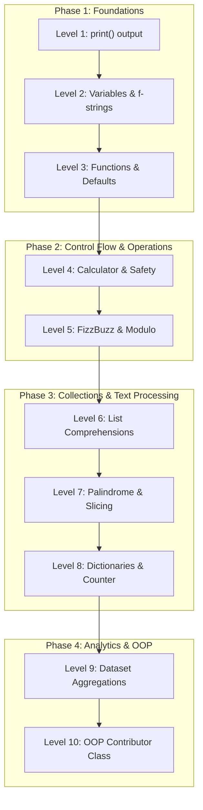

# 🐍 Python Track — 10 Progressive Coding Levels

Welcome to the **Python Track**!

Whether you are writing your first Python script or deepening your knowledge of data structures, string manipulation, and Object-Oriented Programming (OOP), this track offers 10 hands-on, progressive challenges designed to take you from printing to the console all the way to building classes and analyzing datasets.

---

## 🛠️ Prerequisites

To run and test your Python code on your computer, you need **Python 3** (version 3.8 or higher is recommended):

1. Check if Python is installed:
   ```bash
   python --version
   # or on Linux/macOS:
   python3 --version
   ```
2. If it is not installed, download the latest version from [python.org/downloads](https://www.python.org/downloads/).

All challenges are designed to work entirely with the **Python Standard Library** (`math`, `re`, `collections`, etc.). No `pip install` or external virtual environments are needed!

---

## 🪜 Level Progression

| Level | Challenge | Difficulty | Key Concepts | Path |
| :---: | :--- | :---: | :--- | :---: |
| **Level 1** | Print Welcome Message | 🟢 Very Easy | `print()`, standard output, script execution | [**Go to Level 1 →**](level-1/) |
| **Level 2** | Variables & f-strings | 🟢 Very Easy | Dynamic typing, f-strings, string formatting | [**Go to Level 2 →**](level-2/) |
| **Level 3** | Functions & Default Values | 🟢 Easy | `def`, default arguments, `return`, `__main__` | [**Go to Level 3 →**](level-3/) |
| **Level 4** | Basic Arithmetic Calculator | 🟢 Easy | Math operators, `if-elif-else`, division by zero check | [**Go to Level 4 →**](level-4/) |
| **Level 5** | Conditionals & Logic (FizzBuzz) | 🟡 Easy+ | Modulo operator `%`, `range()`, loops, sequence building | [**Go to Level 5 →**](level-5/) |
| **Level 6** | Lists & Filtering | 🟡 Intermediate- | List comprehensions, condition filtering, squaring evens | [**Go to Level 6 →**](level-6/) |
| **Level 7** | String Manipulation & Palindromes | 🟡 Intermediate | Regex (`re.sub`), case normalization, slicing `[::-1]` | [**Go to Level 7 →**](level-7/) |
| **Level 8** | Dictionaries & Word Frequencies | 🟡 Intermediate | `dict`, regex tokens, `collections.Counter`, metrics | [**Go to Level 8 →**](level-8/) |
| **Level 9** | Data Aggregation & Score Records | 🔴 Intermediate+ | Dataset processing, `lambda`, min/max/average stats | [**Go to Level 9 →**](level-9/) |
| **Level 10** | OOP ContributorProfile Class | 🔴 Advanced- | `class`, `__init__`, `self`, encapsulation, `to_dict` | [**Go to Level 10 →**](level-10/) |

---

## 📚 4 Learning Phases



---

## 🚀 How to Complete a Challenge

1. **Pick a level:** Start with [`challenges/python/level-1/`](level-1/) or navigate to any level.
2. **Read the instructions:** Open the level's `README.md` to learn the concept and review requirements.
3. **Create your file:** Inside the level folder, create a file named `<your-username>.py`:
   ```text
   challenges/python/level-1/<your-username>.py
   ```
4. **Run your code:** Test your script in your terminal:
   ```bash
   python challenges/python/level-1/<your-username>.py
   # or:
   python3 challenges/python/level-1/<your-username>.py
   ```
5. **Compare:** Inspect [`jan.py`](level-1/jan.py) in each folder for a complete working reference solution.
6. **Submit:** Commit your file and open a Pull Request!

---

## 📜 Python Track Guidelines

- **File Naming:** Always use your exact GitHub username (e.g. `octocat.py`).
- **Code Conventions:** Follow [PEP 8](https://peps.python.org/pep-0008/) style standards (4 spaces indentation, snake_case function names).
- **Type Annotations:** Use Python type hints where applicable (`def greet(name: str = "World") -> str:`).
- **Execution Guard:** Include an `if __name__ == "__main__":` block to demonstrate your code running.
- **Self-Contained:** Rely only on standard library modules (`re`, `collections`, `math`).
- **Respect Others:** Never edit or delete other contributors' solution files.

---

## 🏁 Ready to code?

👉 **[Start with Level 1: Print Your Welcome Message →](level-1/)**
