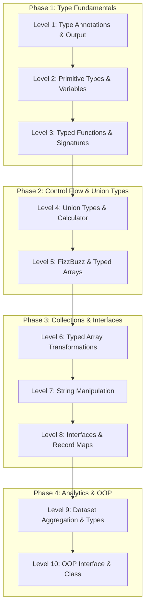

# 🔷 TypeScript (TS) Track — 10 Progressive Coding Challenges

Welcome to the **TypeScript Track**!

Whether you are transitioning from JavaScript or building production-ready applications with static types, this track offers 10 hands-on, progressive challenges designed to take you from basic primitive annotations to advanced interfaces, union types, generics, and Object-Oriented design patterns.

---

## 🛠️ Prerequisites

To run and test your TypeScript code on your computer, you need **Node.js** (version 22.6+ recommended):

1. Check your Node.js version:
   ```bash
   node -v
   ```
2. **Native Execution (Node 22.6+):** Modern Node.js can execute TypeScript files directly without any build step or extra tools:
   ```bash
   node challenges/ts/level-1/<your-username>.ts
   ```
   *(On older Node versions, you can run using `npx tsx challenges/ts/level-1/<your-username>.ts` or `ts-node`)*.

No heavy build configuration or `tsconfig.json` required to get started!

---

## 🪜 Level Progression

| Level | Challenge | Difficulty | Key Concepts | Path |
| :---: | :--- | :---: | :--- | :---: |
| **Level 1** | Print Welcome Message | 🟢 Very Easy | `string` type annotation, `console.log()` | [**Go to Level 1 →**](level-1/) |
| **Level 2** | Variables & Explicit Types | 🟢 Very Easy | Primitive types (`string`, `number`, `boolean`), template literals | [**Go to Level 2 →**](level-2/) |
| **Level 3** | Functions & Typed Signatures | 🟢 Easy | Function signatures, default parameters, return types | [**Go to Level 3 →**](level-3/) |
| **Level 4** | Basic Arithmetic Calculator | 🟢 Easy | Union types (`type Operation = ...`), zero-check, return unions | [**Go to Level 4 →**](level-4/) |
| **Level 5** | Conditionals & Logic (FizzBuzz) | 🟡 Easy+ | `string[]` arrays, loop bounds, modulo logic `%` | [**Go to Level 5 →**](level-5/) |
| **Level 6** | Array Methods (`filter` & `map`) | 🟡 Intermediate- | `number[]` methods, type inference, predicates | [**Go to Level 6 →**](level-6/) |
| **Level 7** | String Manipulation & Palindromes | 🟡 Intermediate | Regex cleanup, `boolean` contract, string reversal | [**Go to Level 7 →**](level-7/) |
| **Level 8** | Objects & Word Frequency Counter | 🟡 Intermediate | `Record<string, number>`, custom `interface`, hash maps | [**Go to Level 8 →**](level-8/) |
| **Level 9** | Data Aggregation & Score Records | 🔴 Intermediate+ | Typed records, `interface`, `readonly`, `.reduce()` | [**Go to Level 9 →**](level-9/) |
| **Level 10** | OOP Class & Interface Implementation | 🔴 Advanced- | `interface`, `class`, `implements`, encapsulation, access modifiers | [**Go to Level 10 →**](level-10/) |

---

## 📚 4 Learning Phases



---

## 🚀 How to Complete a Challenge

1. **Pick a level:** Start with [`challenges/ts/level-1/`](level-1/) or navigate to any level.
2. **Read the instructions:** Open the level's `README.md` to learn the concept and review requirements.
3. **Create your file:** Inside the level folder, create a file named `<your-username>.ts`:
   ```text
   challenges/ts/level-1/<your-username>.ts
   ```
4. **Run your code:** Test your script using Node.js:
   ```bash
   node challenges/ts/level-1/<your-username>.ts
   ```
5. **Compare:** Inspect [`jan.ts`](level-1/jan.ts) in each folder for a complete working reference solution.
6. **Submit:** Commit your file and open a Pull Request!

---

## 📜 TypeScript Track Guidelines

- **File Naming:** Always use your exact GitHub username with the `.ts` extension (e.g. `octocat.ts`).
- **Explicit Types:** Use TypeScript's static type annotations (`: string`, `: number`, `: boolean`, interfaces) rather than defaulting to `any`.
- **Strict & Clean:** Write readable, formatted code adhering to standard TypeScript best practices.
- **Respect Others:** Never edit or delete other contributors' solution files.

---

## 🏁 Ready to code?

👉 **[Start with Level 1: Print Welcome Message →](level-1/)**

