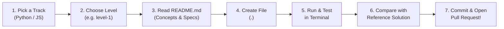

# 🚀 Coding Levels — Learn by Building in Open Source

Welcome to the **Coding Levels** section of *Good First Issue*!

Adding your contributor card in `assets/cards/` taught you the fundamentals of Git, branches, and Pull Requests. Now it's time to **level up your actual programming skills** directly inside an open-source repository!

---

## 🧭 Why Coding Levels?

Learning syntax from videos or books is fine, but **real learning happens when you write code, run it, test it, and submit it**:

- 🛠️ **Hands-on Practice:** Real problems, real files, running on your computer.
- 🪜 **Progressive Difficulty:** 10 curated levels per track that build seamlessly on top of each other.
- 🧪 **Self-Contained & Tested:** Every level includes clear requirements, expected terminal outputs, and an exact reference solution (`jan.py` / `jan.js`).
- 🤝 **Real Open Source Experience:** Your code becomes part of a public repository reviewed by peers.

---

## 🗺️ Available Tracks

Choose the track that fits your learning goals (or do both!):

| Track | Status | Levels | Focus & Technologies | Link |
| :--- | :---: | :---: | :--- | :--- |
| **Python** 🐍 | ✅ **Active** | 10 Levels | Clean syntax, functions, list comprehensions, regex, dictionaries, data analysis, and OOP | [**Enter Python Track →**](python/) |
| **JavaScript** 🟨 | ✅ **Active** | 10 Levels | Modern ES6+, template literals, arrow functions, array methods (`filter`, `map`), objects, and ES6 classes | [**Enter JavaScript Track →**](js/) |
| **HTML** 🌐 | ⏳ *Coming soon* | 10 Levels | Semantic structure, accessible forms, meta tags, and interactive components | *Planned* |
| **CSS** 🎨 | ⏳ *Coming soon* | 10 Levels | Selectors, Flexbox, CSS Grid, custom properties, animations, and responsive design | *Planned* |
| **TypeScript** 🔷 | ⏳ *Coming soon* | 10 Levels | Static types, interfaces, generics, type guards, and modern TS patterns | *Planned* |
| **Go** 🩵 | ⏳ *Coming soon* | 10 Levels | Strong typing, structs, slices, error handling, goroutines, and channels | *Planned* |
| **Rust** 🦀 | ⏳ *Coming soon* | 10 Levels | Ownership, borrowing, pattern matching, structs, traits, and error handling | *Planned* |

---

## 📊 Curriculum Matrix (Levels 1 – 10)

Both active tracks follow a mirrored 4-phase pedagogical curriculum:

| Level | Topic | 🐍 Python Focus | 🟨 JavaScript Focus | Difficulty |
| :---: | :--- | :--- | :--- | :---: |
| **1** | Terminal Greeting | `print()`, script execution | `console.log()`, Node.js runtime | 🟢 Very Easy |
| **2** | Variables & Strings | Dynamic typing, f-strings | `const`/`let`, template literals | 🟢 Very Easy |
| **3** | Reusable Functions | `def`, default arguments, `return` | `function`, default params, `return` | 🟢 Easy |
| **4** | Calculator & Safety | Math operators, division by zero check | Arithmetic operators, defensive conditionals | 🟢 Easy |
| **5** | Logic & FizzBuzz | Modulo `%`, `range()`, loops | Modulo `%`, `for` loop, conditions | 🟡 Easy+ |
| **6** | Data Filtering & Transform | List comprehensions, positive evens squared | `.filter()` & `.map()`, method chaining | 🟡 Intermediate- |
| **7** | Palindrome Checker | String slicing `[::-1]`, regex cleanup | Array reverse `.reverse()`, regex replacement | 🟡 Intermediate |
| **8** | Word Frequency Analyzer | Dictionaries, `collections.Counter` | Objects as hash maps, word frequency | 🟡 Intermediate |
| **9** | Dataset Aggregation | Analytics on list of dicts, min/max/avg | Array `.reduce()`, sorting, metric summaries | 🔴 Intermediate+ |
| **10** | Contributor OOP Class | `class ContributorProfile`, methods, serialization | `class ContributorProfile`, methods, `toJSON` | 🔴 Advanced- |

---

## 📌 How to Complete a Level (Step-by-Step)

Follow this universal workflow for every level you tackle:



### 1. Choose your track & level
Navigate into the track folder:
- Python: [`levels/python/`](python/)
- JavaScript: [`levels/js/`](js/)

Start at `level-1` (recommended) or pick the level matching your current skill.

### 2. Read the level's `README.md`
Every level folder contains a dedicated `README.md` with:
- 📖 **Core Concept Explanation**: Why this concept matters and how it works.
- 🎯 **Objective**: Clear statement of the goal.
- 📋 **Requirements**: Precise parameters, return types, and edge cases.
- 💡 **Code Walkthrough**: Concrete syntax examples.
- 🧪 **Testing Command**: The exact command to run your solution.

### 3. Create your solution file
Inside the target level folder, create a new file named strictly with your **GitHub username**:
- Python: `levels/python/level-X/<your-username>.py` *(e.g. `levels/python/level-1/octocat.py`)*
- JavaScript: `levels/js/level-X/<your-username>.js` *(e.g. `levels/js/level-1/octocat.js`)*

### 4. Implement and run your code locally
Test your solution using your terminal:
- **Python:**
  ```bash
  python levels/python/level-X/<your-username>.py
  # or:
  python3 levels/python/level-X/<your-username>.py
  ```
- **JavaScript (Node.js):**
  ```bash
  node levels/js/level-X/<your-username>.js
  ```

Verify that the terminal output matches the expected output documented in the level's guide.

### 5. Check against the reference solution
Each level contains a working reference solution (`jan.py` or `jan.js`). Inspect it if you get stuck or want to compare coding styles!

### 6. Commit, push, and open your PR!
```bash
git add levels/<track>/level-X/<your-username>.<ext>
git commit -m "feat(levels): add <your-username> solution for <track> level-X"
git push origin <your-branch-name>
```
Then visit GitHub and submit your Pull Request!

---

## 📜 Golden Rules

1. **Only Add Your Own File:** Only create `levels/<track>/level-X/<your-username>.<ext>`. Never modify or delete any other contributor's code or reference files.
2. **Zero External Dependencies:** Solutions must use standard built-in features (Standard Library in Python, built-in JavaScript/Node APIs). No `npm install` or `pip install` required!
3. **Clean & Readable Code:** Use descriptive variable names, handle edge cases, and add comments when helpful.
4. **Be Welcoming:** Learning to code is a journey — encourage fellow contributors in PR reviews!

---

## ❓ Frequently Asked Questions (FAQ)

<details>
<summary><b>Do I have to complete all 10 levels in order?</b></summary>
<br/>
We strongly recommend doing them sequentially from Level 1 to Level 10 because concepts build upon previous levels. However, if you already have programming experience, feel free to jump to any level you'd like to practice!
</details>

<details>
<summary><b>Can I submit multiple levels in a single Pull Request?</b></summary>
<br/>
Yes! You can either submit one level per PR or complete multiple levels on the same branch and submit them together. Both approaches are welcome.
</details>

<details>
<summary><b>What if my solution is different from `jan.py` or `jan.js`?</b></summary>
<br/>
That's totally fine and encouraged! There are multiple ways to solve any programming problem. As long as your code meets all functional requirements and handles edge cases, your approach is valid.
</details>

<details>
<summary><b>How do I install Python or Node.js if I don't have them?</b></summary>
<br/>

- **Python:** Download the latest version from [python.org/downloads](https://www.python.org/downloads/).
- **Node.js:** Download the LTS version from [nodejs.org](https://nodejs.org/).
</details>

---

## 🏁 Ready to begin?

Pick a track and dive into Level 1:

- 🐍 **[Start Python Track (levels/python/)](python/)**
- 🟨 **[Start JavaScript Track (levels/js/)](js/)**
