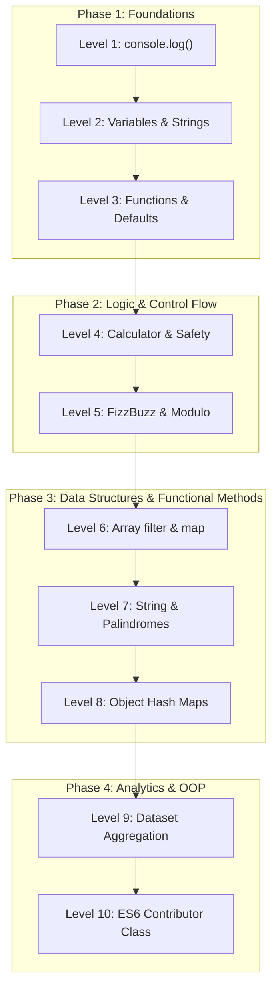

# 🟨 JavaScript (JS) Track — 10 Progressive Coding Levels

Welcome to the **JavaScript Track**! 

Whether you're writing your very first line of JavaScript or polishing your skills with modern ES6+ concepts, this track offers 10 hands-on, progressive challenges designed to take you from printing to the console all the way to Object-Oriented Programming and data processing.

---

## 🛠️ Prerequisites

To run and test your JavaScript code on your computer, you need **Node.js**:

1. Check if Node.js is already installed:
   ```bash
   node -v
   ```
2. If it is not installed, download the recommended (LTS) version from [nodejs.org](https://nodejs.org/).

No extra packages or `npm install` needed! All challenges use pure JavaScript built-in capabilities.

---

## 🪜 Level Progression

| Level | Challenge | Difficulty | Key Concepts | Path |
| :---: | :--- | :---: | :--- | :---: |
| **Level 1** | Print Welcome Message | 🟢 Very Easy | `console.log()`, strings, terminal output | [**Go to Level 1 →**](level-1/) |
| **Level 2** | Variables & Template Literals | 🟢 Very Easy | `const`, `let`, template literals (`` `...${}` ``) | [**Go to Level 2 →**](level-2/) |
| **Level 3** | Functions & Default Parameters | 🟢 Easy | `function`, parameters, default values, `return` | [**Go to Level 3 →**](level-3/) |
| **Level 4** | Basic Arithmetic Calculator | 🟢 Easy | Operators (`+`, `-`, `*`, `/`), `switch`/`if`, zero check | [**Go to Level 4 →**](level-4/) |
| **Level 5** | Conditionals & Logic (FizzBuzz) | 🟡 Easy+ | Modulo operator `%`, loops, conditional ordering | [**Go to Level 5 →**](level-5/) |
| **Level 6** | Array Methods (`filter` & `map`) | 🟡 Intermediate- | Functional arrays, predicate filtering, transformation | [**Go to Level 6 →**](level-6/) |
| **Level 7** | String Manipulation & Palindromes | 🟡 Intermediate | Regex cleanup, string normalization, reversal | [**Go to Level 7 →**](level-7/) |
| **Level 8** | Objects & Word Frequency Counter | 🟡 Intermediate | Objects as hash maps, word frequency, extrema | [**Go to Level 8 →**](level-8/) |
| **Level 9** | Data Aggregation & Score Records | 🔴 Intermediate+ | `.reduce()`, dataset sorting, statistical metrics | [**Go to Level 9 →**](level-9/) |
| **Level 10** | ES6 Classes & OOP Profile | 🔴 Advanced- | `class`, constructor, encapsulation, methods, `toJSON` | [**Go to Level 10 →**](level-10/) |

---

## 📚 4 Learning Phases



---

## 🚀 How to Complete a Challenge

1. **Pick a level:** Start with [`levels/js/level-1/`](level-1/) or navigate to any level.
2. **Read the instructions:** Open the level's `README.md` to learn the concept and review requirements.
3. **Create your file:** Inside the level folder, create a file named `<your-username>.js`:
   ```text
   levels/js/level-1/<your-username>.js
   ```
4. **Run your code:** Test your script using Node.js:
   ```bash
   node levels/js/level-1/<your-username>.js
   ```
5. **Compare:** Inspect [`jan.js`](level-1/jan.js) in each folder for a complete working reference solution.
6. **Submit:** Commit your file and open a Pull Request!

---

## 📜 JavaScript Track Guidelines

- **File Naming:** Always use your exact GitHub username (e.g. `octocat.js`).
- **Modern Standards:** Use ES6+ features (`const`, `let`, arrow functions, template literals).
- **Self-Contained:** Do not import third-party npm packages; stick to native JavaScript features.
- **Respect Others:** Never edit or delete other contributors' solution files.

---

## 🏁 Ready to code?

👉 **[Start with Level 1: Print Welcome Message →](level-1/)**
